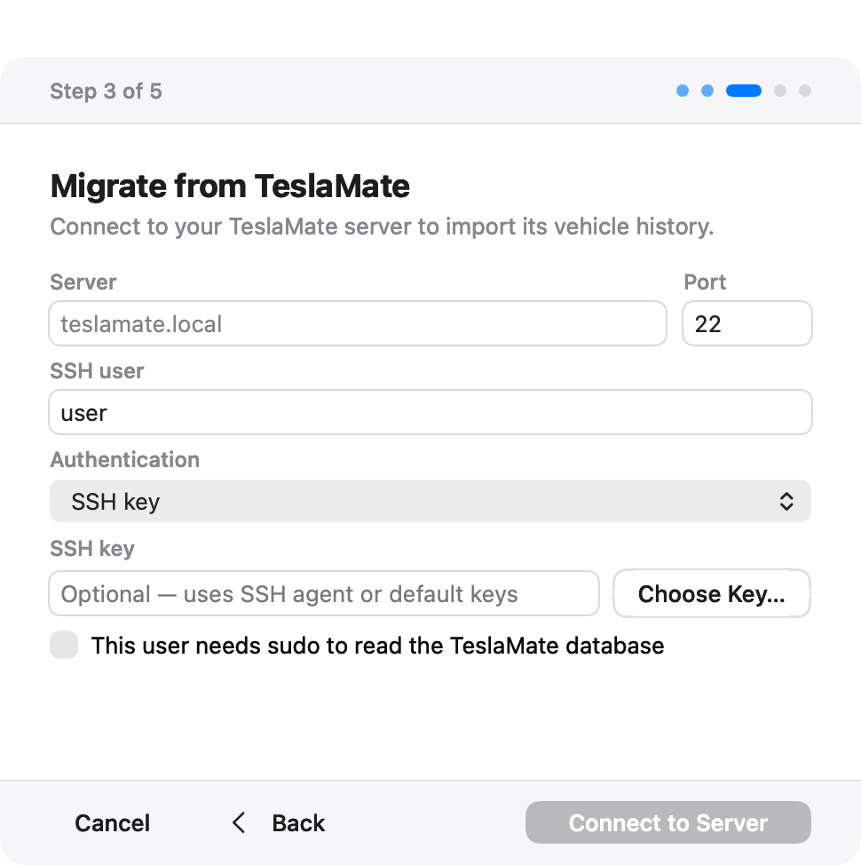

# Mac setup and everyday use

Teslatlas Hub targets Apple-silicon Macs running macOS 13 or later. This guide
describes the installation and control flow; verify it against your exact
source-built artifact before relying on a deployment.

Build the app using [Build from source](build-from-source.md). Prebuilt GitHub
releases are no longer provided. Local builds are ad-hoc signed; they do not
automatically gain Developer ID signing or notarisation. For an existing
installation, follow [Upgrade and rollback](../releases/upgrade.md).

## Install

1. Copy the validated **Teslatlas Hub.app** to `/Applications` or
   `~/Applications`. Keep it on the Mac's local disk; an external volume or
   an App Translocation location cannot host the per-user agent.
2. Open the app from that location.
3. Choose Fleet API, legacy login, or history import.
4. Complete account setup and diagnostics, then choose **Start Hub**. The app
   writes and loads its per-user LaunchAgent after configuration preflight.
5. Confirm the dashboard reports **Hub is running**, diagnostics pass, and
   the intended vehicles and fresh activity are visible. Process health alone
   does not prove that new vehicle data is arriving.

## Connect or migrate

For a new installation, choose **New installation** in setup. Fleet requires
your Tesla Developer application and the configuration described in
[Fleet setup](fleet-setup.md). Legacy requires an existing Owner API token
pair. Do not leave another service refreshing the same Legacy credentials.

To bring existing history across, choose **Import History** and follow
the [migration checklist](../releases/migration.md#before-you-start). Enter the
server, SSH port and user. Select **SSH key** and use **Choose Key…** to select
your private key, or select **Password** for that authentication path. Leaving
the key field empty uses the SSH agent or default keys. Do not choose the
public key ending in `.pub` or share the private key with support.

Select **This user needs sudo to read the source database** only when the
server account needs that access. Read the compatibility confirmation before
importing. Keep the source application and its backup until you have verified the imported
history and completed the explicit cutover step.



*Actual AppKit interface with fictional demonstration data.*

If a step fails, read its message and open logs before retrying. Authentication,
Docker access and schema compatibility are different failures; changing a
password will not fix a schema rejection. See [Troubleshooting](troubleshooting.md).

## Everyday use

| Control | What it does |
|---|---|
| Dashboard | Shows service, account, database, selected vehicle and recent activity |
| Vehicles | Shows connected vehicles and available command controls |
| Diagnostics | Opens checks and a **Run Again** action |
| Logs | Opens a separate, resizable window with scrolling, Copy and Save |
| Service Details | Shows service information and uninstall controls |
| Manage Tesla | Offers connection changes and migration actions |

Vehicle commands affect the real vehicle. Use only the intended action and
review any confirmation; do not send commands merely to test the interface.

### Close, quit or stop collection

- **Command-W** or the window's red close control closes that window. Closing
  the last app window exits the control app, not the background service.
- **Command-Q** or **Quit Teslatlas Hub** quits the control app. An active
  protected setup/import operation may need to finish first; the app explains
  this instead of interrupting the operation.
- **Stop Hub…** stops the service and pauses collection. **Restart Hub**
  restarts the service. Quitting the app is not a substitute for stopping Hub.
- **Command-L** opens logs. Return activates the enabled default action where
  one is provided. Use the Edit menu shortcuts to work with text fields.

The host must remain available for collection; closing the app does not make
an asleep or powered-off Mac collect data. For client connection instructions,
see [Pair your client](getting-started.md#pair-your-client).

## How the service is installed

The app writes `~/Library/LaunchAgents/com.teslatlas.hub.plist` for the signed-in
user. The agent runs the Hub binary embedded in the app with the private
per-user configuration. Start validates that configuration before enabling and
loading the agent. A failed preflight keeps Hub stopped.

After the app is replaced or moved, it rewrites the agent to reference the
current app and replaces an older app-managed, Rust-installed or installer-era
agent. Configuration and data stay in the user's Hub folder. The app does not
remove an installer-era root payload; see the administrator cleanup below.

## Service controls

Use **Start Hub**, **Stop Hub…** and **Restart Hub** in the app. Stop persists
across logins and reboots until **Start Hub** enables the agent again. There
are no macOS CLI `install` or `service` verbs. For data commands, use the
[app-embedded CLI](cli.md#platform-invocation) as the signed-in user.

Stopping Hub pauses collection and closes streaming, HTTP, command-proxy, and
supervised companion connections. Stored history remains intact.

## Logs and diagnostics

Press **Command-L** in the app to open bounded, redacted app and service logs.
**Run Diagnostics** performs `doctor`, `preflight`, `status`, database,
credential, connection, and recent-log checks.

Copy and Save use the same redaction pass. Review every report before sharing
it; precise telemetry is sensitive even when ordinary identifiers are removed.

## Uninstall

Service Details offers two choices:

- **Remove Background Service** removes the per-user agent and preserves all
  Hub data, configuration and logs.
- **Delete Hub and Data** confirms removal of the service, Hub support folder,
  logs and the app's own settings and caches. Backups and exports saved
  elsewhere remain. It refuses with a reason if the Hub folder contains a
  backup, export, link or another disk.

Move the app to the Trash last, after the service has been removed.

For terminal-only service removal, run these as the signed-in user in order.
If bootout reports that the job is already absent, continue; resolve other
errors before removing its plist:

```sh
launchctl bootout gui/$(id -u)/com.teslatlas.hub
launchctl enable gui/$(id -u)/com.teslatlas.hub
rm "$HOME/Library/LaunchAgents/com.teslatlas.hub.plist"
```

Terminal-only data removal follows agent removal: after checking backups,
exports, links and mount points, remove only
`~/Library/Application Support/Teslatlas Hub` and
`~/Library/Logs/Teslatlas Hub`. Move the app to the Trash last.

### Installer-era administrator cleanup

The app replaces the old per-user agent but leaves its root-owned payload
alone. After every local user has removed or replaced their old agent, an
administrator can remove `/Library/Application Support/Teslatlas Hub` and the
old `/private/var/tmp/com.teslatlas.hub-upgrade-<uid>` directory for each
identified user. Check each exact target before removal; the per-user Hub data
under `~/Library` is separate. Forget the two old receipts with
`sudo pkgutil --forget com.teslatlas.hub.service` and
`sudo pkgutil --forget com.teslatlas.hub.app`.

## Build from source

See [Build from source](build-from-source.md) for the workspace-specific app
builder and its limitations. Source builds do not automatically gain trusted
signing or notarisation.
